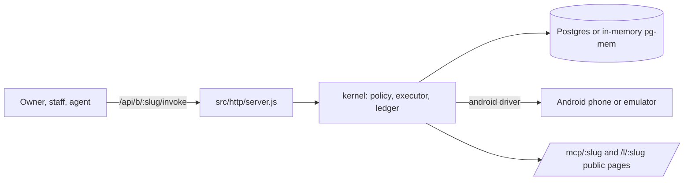

# cybercheck-orchestrator

Node kernel (package name `ghost-platform`) where every business action is permission-checked, executed and written to a hash-chained receipt log.

## What it is

The core engine of a planned business-automation platform. An owner, staff member, automation or AI agent asks for a capability; the kernel checks a policy (auto, ask or never), runs it, verifies the result and records a receipt. The source was rebuilt from PDF printouts (see `RECOVERY.md`), so it is incomplete: only 2 of 14 planned modules are present and the demo scripts named in `package.json` are missing.

## How it works

- `src/kernel/` (23 files): `executor.js` (request, plan, route, approval, execute, verify, receipt), `policy.js` (capabilities and grants), `ledger.js` (hash-chained receipts), `canonical.js` (versioned business facts and drift), `installer.js` and `registry.js` (packages), `signing.js` (HMAC package signatures), `router.js` (model choice by need and cost), `harness.js` (goal-driven agents), `mcp.js`, `links.js` (public link pages), `builder.js`, `importer.js`, `providers.js`, `workspace.js`, `automation.js`.
- `src/platform.js` wires the kernel together. `src/db.js` uses Postgres when `DATABASE_URL` is set, otherwise an in-memory `pg-mem` database (a reconstruction, per `RECOVERY.md`).
- `src/http/server.js` (281 lines, Express 5) has about 49 route registrations: `/api/packages`, `/api/capabilities`, `/api/b/:slug/{installs,invoke,approvals,receipts,workspaces,device/*,sync,harness,build,import,...}`, `/mcp/:slug`, `/l/:slug`, `/p/:slug`, `/embed/:slug/:section`.
- `src/drivers/android.js`: a driver for operating other apps on an Android phone or cloud emulator.
- `db/001_kernel.sql` to `db/004_marketplace.sql`: the Postgres schema.
- `modules/` holds only `availability` and `business_profile`.

## Run it

```sh
npm install
npm run verify     # verify.mjs, runs against in-memory pg-mem; steps ran through in a test here
npm start          # node src/http/server.js
```

Environment variable names: `DATABASE_URL` (optional; in-memory database if unset), `PORT`, `PACKAGE_SIGNING_KEY` (package signing; a development default is used if unset). The scripts `demo`, `demo:device`, `demo:modular` and `demo:surfaces` point at files that are not in the repo.

## Status

Stalled: a working core reconstructed from printouts, missing 12 of 14 modules and its demos, and nothing else in the account calls it.

## Where it fits



## Related repos

None share code with it. It is the kernel concept behind the CyberCheck / Gulf Coast Radar stack; its `canonical.js` and `directory.js` overlap in idea, not code, with the business-data layer in `gcr-api-clean`. It does not use Supabase.
